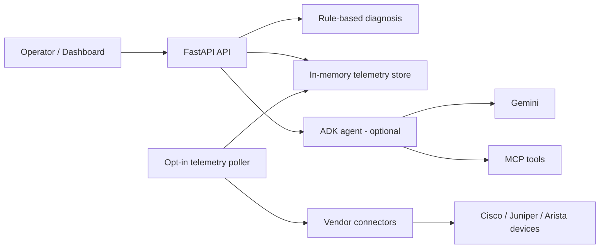

# Agentic NetOps

[](https://github.com/anirudh1937/agentic-netops-/actions/workflows/tests.yml)
[](https://www.python.org/)
[](https://fastapi.tiangolo.com/)
[](LICENSE)

**AI-assisted network operations with deterministic diagnosis, vendor-aware
telemetry connectors, and a safe-by-default polling lifecycle.**

Agentic NetOps is a FastAPI service for ingesting network telemetry, detecting
anomalies with explainable rules, and optionally using Google ADK, Gemini, and
MCP tools to produce operational analysis. It includes a Cisco IOS XE RESTCONF
adapter, vendor connector abstractions for Cisco, Juniper, and Arista, a
built-in dashboard, and a read-only API for the latest polled telemetry.

## Highlights

- **Explainable first:** deterministic diagnosis rules identify high CPU,
  memory pressure, packet loss, latency, and interface-down conditions with
  evidence and recommendations.
- **Vendor-aware:** a common connector interface keeps device-access logic out
  of the API layer and makes additional vendors straightforward to add.
- **Safe by default:** background polling is disabled unless explicitly enabled,
  and `GET /telemetry/latest` only reads local state.
- **Agent-ready:** the optional `/analyze` path combines Google ADK, Gemini, and
  MCP tools with the deterministic diagnosis output.
- **Offline-testable:** the default test suite uses fakes and mocks. Live device
  and model integrations are opt-in and skipped by default.
- **Dashboard included:** a small browser UI exercises telemetry input,
  diagnosis, agent analysis, and backend health.

## Architecture



The polling path is deliberately separate from the read path. The poller is the
only component that writes polled readings, while the API exposes those readings
without initiating another poll. See [docs/architecture.md](docs/architecture.md)
for component-level details.

## Features

### Telemetry and diagnosis

- Validates the shared `NetworkTelemetry` model used by the API, dashboard, and
  agent tools.
- Runs a deterministic diagnosis engine that returns severity, anomalies,
  evidence, and a recommended action.
- Treats unavailable metrics as `null` instead of zero-filling them, so a
  diagnosis only reflects data the device actually reported.

### Vendor connectors

- Cisco IOS XE RESTCONF adapter with read-only telemetry and inventory support.
- Shared connector interface for Cisco, Juniper, and Arista.
- Missing configuration is reported by `/integrations` and the poller instead
  of being treated as a healthy device.
- Credential-safe error handling keeps secrets out of API responses and stored
  readings.

### Controlled polling

- Disabled by default; enabled with `NETOPS_POLL_ENABLED=true`.
- One poller task per application process, with non-overlapping poll cycles.
- Readings keyed by `(vendor, device_id, interface)`.
- Latest poll attempt is tracked separately from the last successful
  measurement.
- A first-poll failure does not fabricate a device identity.
- In-memory store by design: data resets when the process restarts.

### Optional AI and MCP

- `/analyze` uses the configured Google ADK/Gemini backend to produce a
  plain-English operational summary.
- The MCP server exposes `check_device_health` for the same core telemetry
  fields.
- If the agent backend is unavailable, the endpoint fails cleanly with HTTP
  `503` rather than returning a partial response.

## Quick start

### Prerequisites

- Python 3.12+
- A virtual environment is recommended.

```powershell
python -m venv .venv
.\.venv\Scripts\Activate.ps1
python -m pip install -r requirements.txt
Copy-Item .env.example .env
uvicorn app.main:app --reload
```

On macOS/Linux:

```bash
python -m venv .venv
source .venv/bin/activate
python -m pip install -r requirements.txt
cp .env.example .env
uvicorn app.main:app --reload
```

Open:

- Dashboard: <http://127.0.0.1:8000/dashboard>
- Interactive API docs: <http://127.0.0.1:8000/docs>
- Health check: <http://127.0.0.1:8000/health>

The application starts without Cisco credentials, Gemini credentials, or any
live device access. Configure only the integrations you intend to use.

## Configuration

Copy `.env.example` to `.env` and fill in only the values you need. Never commit
`.env`.

| Variable | Required | Purpose |
| --- | --- | --- |
| `GEMINI_API_KEY` | Optional | Enables the `/analyze` agent path. |
| `CISCO_SANDBOX_HOST` | Optional | Cisco IOS XE RESTCONF host. |
| `CISCO_SANDBOX_USERNAME` | Optional | Cisco RESTCONF username. |
| `CISCO_SANDBOX_PASSWORD` | Optional | Cisco RESTCONF password. |
| `CISCO_SANDBOX_API_ROOT` | Optional | RESTCONF API root; defaults to `/restconf`. |
| `CISCO_SANDBOX_VERIFY_TLS` | Optional | Set to `true` to verify the device TLS certificate. |
| `NETOPS_POLL_ENABLED` | Optional | Set to `true` to start background polling. Default: disabled. |

The example file also contains `GOOGLE_CLOUD_PROJECT` and
`CISCO_SANDBOX_INTERFACE`; the current application does not read those values
directly. Select the Cisco interface with the `interface` query parameter.

Juniper and Arista connectors read `JUNIPER_SANDBOX_*` and `ARISTA_SANDBOX_*`
environment variables when those integrations are used.

## API

| Method | Path | Description |
| --- | --- | --- |
| `GET` | `/` | Service banner. |
| `GET` | `/health` | Readiness probe. |
| `GET` | `/dashboard` | Built-in dashboard. |
| `POST` | `/telemetry` | Validate and echo a telemetry payload. |
| `GET` | `/telemetry/latest` | Read the latest stored polled readings. Never starts a poll. |
| `POST` | `/diagnose` | Run the deterministic diagnosis engine. |
| `GET` | `/cisco/telemetry` | Fetch Cisco telemetry and run diagnosis. |
| `GET` | `/vendors` | List registered vendor connectors. |
| `GET` | `/vendors/{vendor}/telemetry` | Fetch vendor telemetry and run diagnosis. |
| `GET` | `/vendors/{vendor}/inventory` | Return a device/interface inventory snapshot. |
| `GET` | `/integrations` | Report backend, agent, MCP, and vendor connectivity/inventory status. |
| `POST` | `/analyze` | Run the optional ADK/Gemini analysis path. |

### Example: diagnosis

```json
{
  "device_id": "router-01",
  "interface": "GigabitEthernet0/1",
  "timestamp": "2026-08-25T00:00:00Z",
  "cpu_percent": 92,
  "memory_percent": 60,
  "bandwidth_mbps": 100,
  "packet_loss_percent": 5,
  "latency_ms": 150,
  "interface_status": "up"
}
```

Send it to `POST /diagnose` to receive severity, anomalies, evidence, and a
recommended action.

### Example: latest telemetry

`GET /telemetry/latest` returns already-stored readings:

```json
{
  "readings": [],
  "count": 0,
  "generated_at": "2026-10-29T00:00:00+00:00"
}
```

Each non-empty reading includes the vendor/device/interface identity, the latest
poll outcome, the last successful measurement, failure count, and any sanitized
error.

## Polling lifecycle

Polling is intentionally opt-in:

```powershell
$env:NETOPS_POLL_ENABLED = "true"
uvicorn app.main:app --reload
```

When enabled, the FastAPI lifespan creates one application-owned store and
poller, starts the poller, and stops it cleanly on shutdown. When disabled, the
poller object exists but no background task is started.

The current implementation supports one configured connector per vendor.
Multi-device polling and persistent storage are future work; multi-worker
deployments are not supported by the current in-memory store.

## Testing

Run the offline suite:

```powershell
.\.venv\Scripts\python.exe -m pytest -q
```

or:

```bash
python -m pytest -q
```

The default suite does not contact Cisco, Juniper, Arista, Gemini, or any other
external service. Live integration tests are opt-in and are skipped unless the
corresponding environment flags are set. CI runs only the offline suite.

## Project structure

```text
app/
  api/                  FastAPI request/response helpers
  cisco/                Cisco IOS XE RESTCONF adapter
  connectors/           Vendor connector abstraction and implementations
  dashboard/            Built-in browser dashboard
  mcp/                  MCP server and network tools
  agents/               Google ADK agent configuration and tools
  diagnosis.py          Deterministic diagnosis rules
  telemetry_poller.py   Controlled background polling
  telemetry_store.py    In-memory telemetry store
  main.py               FastAPI application and lifespan
tests/                  Offline and opt-in integration tests
docs/                   Architecture and implementation notes
.github/workflows/      GitHub Actions CI
```

## Security

- `.env` is ignored and must never be committed.
- RESTCONF access is read-only; this project does not perform remediation.
- Device credentials are never returned. Connector errors use credential-safe
  messages, and unexpected exception details are reduced to class names or
  stable, sanitized messages.
- `GET /telemetry/latest` never triggers a network request.
- Endpoints such as `/cisco/telemetry`, `/vendors/{vendor}/telemetry`, and
  `/integrations` contact configured devices and should be protected before
  exposure to untrusted networks.
- The optional `/analyze` path sends submitted telemetry to the configured
  model backend. Do not submit sensitive production data unless that is
  acceptable for your environment.

For vulnerability reporting, see [SECURITY.md](SECURITY.md).

## Roadmap

- Add authentication and authorization for externally exposed APIs.
- Add a persistent telemetry store while preserving the current freshness
  semantics.
- Support multiple devices per vendor.
- Expand vendor-specific telemetry and inventory coverage.
- Add request tracing and structured observability.
- Add deployment packaging and example reverse-proxy configuration.

## Contributing

Contributions are welcome. See [CONTRIBUTING.md](CONTRIBUTING.md) for local
setup, testing, and pull-request guidance.

## License

This project is licensed under the MIT License. See [LICENSE](LICENSE).
