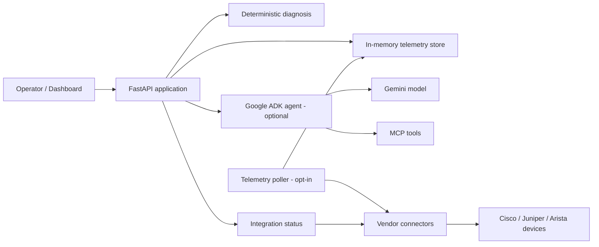
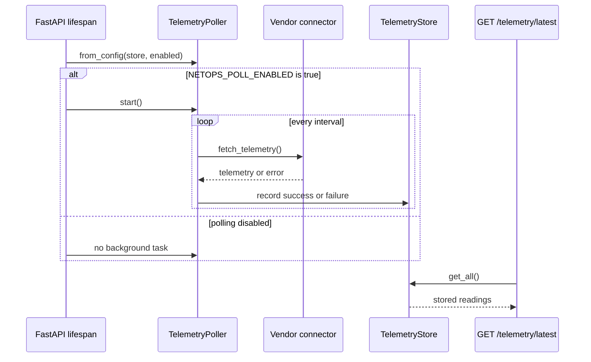

# Architecture

This document describes the main runtime paths in Agentic NetOps and the safety
boundaries between them.

## Component overview



## Request paths

### Ingest and diagnose

1. A telemetry payload is validated by the shared `NetworkTelemetry` model.
2. The deterministic diagnosis engine evaluates CPU, memory, packet loss,
   latency, and interface state.
3. The response contains severity, anomalies, evidence, and a recommended
   action.

This path is local and does not require an external model.

### Read latest polled telemetry

`GET /telemetry/latest` reads from the application-owned `TelemetryStore` and
returns the stored readings. It does not call `poll_once()`, start a poller, or
contact a device.

### Fetch live vendor telemetry

`GET /cisco/telemetry` and `GET /vendors/{vendor}/telemetry` resolve a connector
from the vendor registry, fetch telemetry through the connector, and run the
same deterministic diagnosis engine. These paths contact configured devices and
should be protected before exposure to untrusted networks.

### Optional agent analysis

`POST /analyze` runs the ADK agent against telemetry. The agent may use the
deterministic diagnosis tool and MCP tools. When the model backend is
unavailable, the endpoint returns HTTP `503` with a stable, credential-safe
error response.

## Polling lifecycle



The poller is disabled by default. When disabled, the application still creates
the store and poller objects but does not start a background task.

## Store semantics

Readings are keyed by the composite identity:

```text
(vendor, device_id, interface)
```

Each reading tracks:

- the latest poll attempt timestamp and outcome
- the last successful telemetry measurement
- the last successful fetch timestamp
- consecutive failure count
- a sanitized error message when the latest attempt failed

The latest attempt is intentionally separate from the last successful
measurement. A failed poll must not overwrite the last known good telemetry or
make it appear freshly collected.

The store is in memory and is reset when the process restarts. Multi-worker
deployments are not supported by the current in-memory design.

## Safety boundaries

- Device access is read-only; no remediation actions are implemented.
- Connector configuration failures are reported without exposing credentials.
- Raw exception messages from arbitrary exceptions are replaced with class
  names or stable messages.
- A first-poll failure without a verified device identity does not create a
  fabricated reading.
- The latest-telemetry read path never triggers polling or network access.
- Live integration tests and live-test flags are not part of CI.
